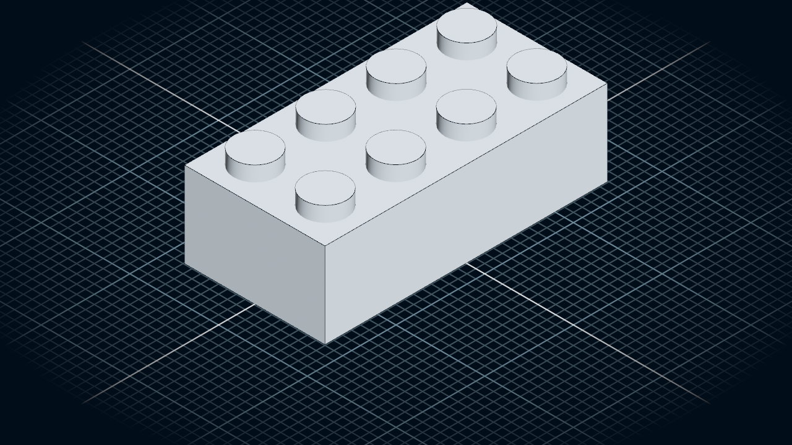

# µcad

[](https://ci.codeberg.org/repos/15446)
[](https://crates.io/crates/mucad)
[](https://deps.rs/repo/codeberg/mucad/mucad)


µcad (pronounced *mucad*) is a declarative programming language for *Computer Aided Design*.

Simple basic shapes can be composed to create complex geometries which then can be rendered into STL
or SVG files, e.g. for 3D printing or CNC milling.

**Note**: This repo is a [fork of microcad](https://codeberg.org/microcad/microcad) to maintain an active release.

Feel free to [contribute](CONTRIBUTE.md) by opening issues or pull requests.

## Content

- [Content](#content)
- [Quick Start](#quick-start)
- [First Example](#first-example)
- [Installation](#installation)
- [Command line usage](#command-line-usage)
- [Using the viewer](#using-the-viewer)
- [Documentation](#documentation)
- [❤️ Support the project](#️-support-the-project)
- [💚 Funded by](#-funded-by)

## Quick Start

*µcad* is programmed in [Rust](https://www.rust-lang.org/) which easily can be
[installed](https://www.rust-lang.org/tools/install) on several operating systems.

You can try it out with an example by using the command line tool `mucad`
which can be installed from [crates.io](https://crates.io/crates/mucad) by using
the following command line:

```sh
cargo install mucad
```

**Note**: Currently µcad has no binary install packages so the only ways to install
it are with [`cargo install`](#installation) or from the source code (see section
[Contribute](CONTRIBUTE.md#contribute-documentation)).

## First Example

The following µcad source code defines a *part* called `CsgCube`, which has a body of a cube with
rounded corners and three cylinders as holes:


```mu,first_example
use std::math::*;
use std::geo3d::*;

part CsgCube(size: Length) {
    body = Sphere(size / 1.5) & Cube(size);
    holes = Cylinder(size, diameter = size / 1.5).orient([X,Y,Z]);
    body - holes;
}

CsgCube(50mm);
```

## Installation

To install the latest release of *µcad* via *cargo*, type:

```sh
cargo install mucad
```

## Command line usage

After installing, you can run a basic example by typing:

```sh
mucad check ./examples/brick.mu
```

This will *check* the input file and will output the model tree.
The *check* command will not export the output geometry.

To generate an STL model file use the `export` command with an additional output file name:

```sh
mucad export ./examples/brick.mu
```

The file [`brick.mu`](examples/brick.mu) generate a file called `brick.stl`
which can be displayed e.g. with [fstl](https://github.com/fstl-app/fstl).

The resulting STL mesh looks like this:



## Using the viewer

To install the latest release of the µcad viewer via *cargo*, type:

```sh
cargo install mucad-viewer
```

You can run the viewer with a file:

```sh
mucad-viewer ./examples/brick.mu
```

## Using the web viewer

The web viewer that used for the [playground](https://play.mucad.org) is located in `editors/web-viewer`.
Please read the [README.md](editors/web-viewer/README.md) in there in order to know how to set it up locally.

## Documentation

- [Language reference](http://docs.mucad.org/)
- [Contribute Documentation](CONTRIBUTE.md)

## Licensing

The µcad compiler is licensed under AGPLv3.0.
The µcad standard library is licensed under MIT license.

## ❤️ Support the project

If you like this project, you can help us spend more time on it by donating:

<a href="https://opencollective.com/mucad/donate" target="_blank">

</a>

## 💚 Funded by

Thanks to the [Prototype Fund](https://www.prototypefund.de/) and the [Federal Ministry of Research, Technology and Space](https://www.bmbf.de/EN/) for funding this project in 2025.


